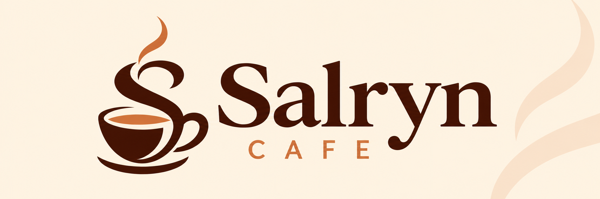

# Salryn Cafe

Offline-first café POS, F&B operations, central sync, and multi-device platform built on the Salryn transactional kernel and Cafe Yza operational domain.

## Authority & Integration Provenance

- **Canonical Dispatch:** [00-INTEGRATION/FORGE-DISPATCH-V2.md](00-INTEGRATION/FORGE-DISPATCH-V2.md)
- **I0 Provenance Report:** [00-INTEGRATION/i0-provenance/I0_PROVENANCE_REPORT.md](00-INTEGRATION/i0-provenance/I0_PROVENANCE_REPORT.md)
- **Kernel Baseline Pin:** `Kirjane/Salryn` (`codex/salryn-r3-canonical-integration-r1`) @ `607fcc4b17e2c069d0fd36d0646c554940977e2d` (preserved under `refs/heads/archive/kernel/*` and `refs/tags/archive/kernel/*`)
- **F&B Domain Reference Pin:** `Kirjane/Salryn-CafeYza` (`main`) @ `4241ea1ec0a8cebf552d93f25a7ac134d7d4d6f3` (preserved under `refs/heads/archive/yza/*`)
- **Destination Brand Root:** `6b266249566c59cf0128c8f2ee8583010316ca1f` (preserved intact in parent history)

## Brand assets

| Asset | File | Use |
| --- | --- | --- |
| App icon | [PNG](assets/brand/salryn-app-icon.png) | Application icon and social profile |
| Banner | [PNG](assets/brand/salryn-banner.png) | Website header and social cover |
| Transparent logo | [PNG](assets/brand/salryn-transparent-logo.png) | Light backgrounds, menus, and packaging |

Original generation prompts are in [prompts.txt](assets/brand/prompts.txt). Assets were created with OpenAI image generation. These are raster PNG files.

## Colors

See the [palette guide](assets/brand/PALETTE.md) for hex values and usage. Use [colors.css](assets/brand/colors.css) in a web application, or [colors.json](assets/brand/colors.json) in other tooling.
