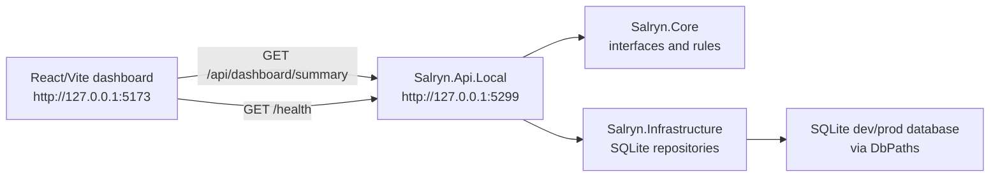
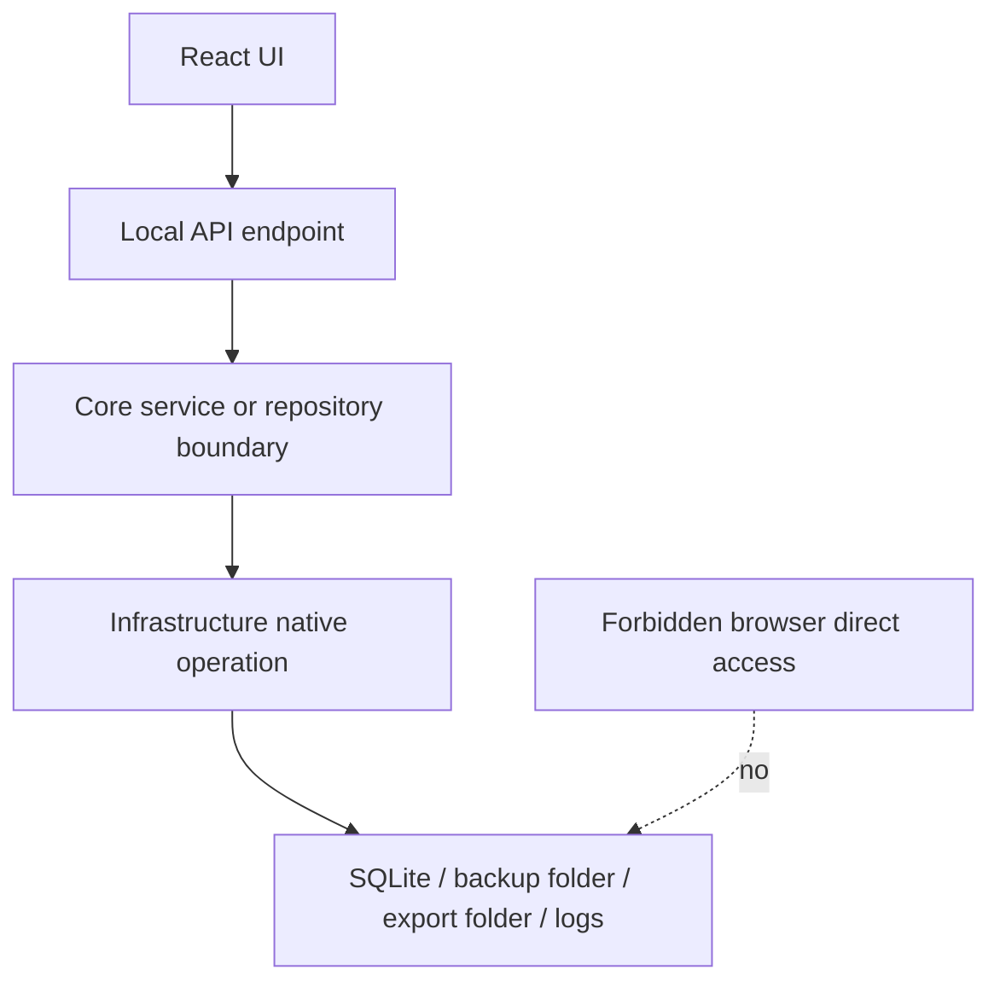
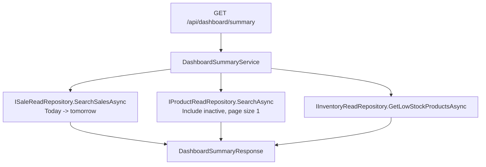
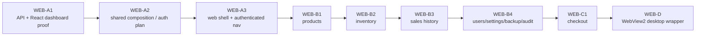

# Salryn Web Frontend Foundation

## Purpose

Salryn keeps its native .NET backend as the source of truth while proving a new Chromium/web operator UI. The web frontend is presentation only. Business rules, SQLite access, filesystem operations, checkout persistence, inventory movement, backup/recovery, audit, and official output remain native .NET responsibilities.

Current WEB-A1 proof:

- `Salryn.Api.Local` exposes a local ASP.NET Core API.
- `Salryn.App.Web` renders a React/Vite dashboard.
- The dashboard reads real backend metrics from `/api/dashboard/summary`.
- WinForms remains the stable fallback.

## Current Project Shape

```text
src/
  Salryn.Core/
    Domain contracts, service rules, repository interfaces, Result/Error types.

  Salryn.Infrastructure/
    SQLite repositories, database initialization, DbPaths, backup/recovery,
    official output filesystem implementation.

  Salryn.Host.Local/
    Core-only local host runtime and handler boundary.

  Salryn.App.WinForms/
    Existing stable WinForms operator app and current production fallback.

  Salryn.Api.Local/
    New local ASP.NET Core Minimal API.
    References Core + Infrastructure only.
    Does not reference WinForms.

  Salryn.App.Web/
    New React + TypeScript + Vite frontend.
    Calls the local API.
    Does not access SQLite, files, printers, or business services directly.

tools/
  Salryn.Tools.CoreSmoke/
    Source and architecture guards.

  Salryn.Tools.InfrastructureSmoke/
    Native regression smoke gates, including POS Phase-B regression.

tests/
  Salryn.Tests/
    Source guards and behavior checks.
```

## WEB-A1 Runtime Flow



## Backend Boundary

The browser must never own local side effects.



Examples:

- Dashboard reads go through `/api/dashboard/summary`.
- Future backup creation should call a native API endpoint, not browser file APIs.
- Future printing/hardware should call a native bridge endpoint, not browser direct hardware access.
- Official output remains behind existing native official output workflow boundaries.

## Local API

Project:

```text
src/Salryn.Api.Local/Salryn.Api.Local.csproj
```

Current endpoints:

```text
GET /health
GET /api/dashboard/summary
```

Security posture:

- Binds to `http://127.0.0.1:5299`.
- Does not bind to `0.0.0.0`.
- Does not use `ListenAnyIP`.
- CORS allows Vite dev origins only:
  - `http://127.0.0.1:5173`
  - `http://localhost:5173`

Run:

```powershell
dotnet run --project .\src\Salryn.Api.Local\Salryn.Api.Local.csproj -- --dev
```

Smoke:

```powershell
dotnet run --project .\src\Salryn.Api.Local\Salryn.Api.Local.csproj -- --dev --smoke-if-supported
```

## Web Frontend

Project:

```text
src/Salryn.App.Web
```

Stack:

- React
- TypeScript
- Vite
- Tailwind CSS
- TanStack Query

Current page:

```text
Dashboard only
```

Run:

```powershell
Set-Location C:\Users\kirch\Salryn\src\Salryn.App.Web
npm install
npm run dev
```

Build:

```powershell
Set-Location C:\Users\kirch\Salryn\src\Salryn.App.Web
npm run build
```

Open:

```text
http://127.0.0.1:5173
```

The API must be running on `127.0.0.1:5299`.

## Dashboard Summary Data



Response fields:

```text
todaySalesTotal
todayTransactionCount
productCount
lowStockCount
refreshedAt
status
warnings
```

## Migration Strategy

WinForms is not deleted. It remains the stable operator fallback while the web UI proves itself module by module.



Recommended next phase:

```text
WEB-A2 - shared native composition and authenticated local API shell.
```

Do not expand endpoints broadly until composition drift is solved.

## Hard Rules

Do not add these unless explicitly assigned:

- product images
- product photo upload
- media upload
- blob image storage
- product file picker
- checkout mutation from web
- sales/payment behavior rewrites
- schema/migrations
- RMO or official output behavior changes
- printer/scanner/hardware
- PDF/Crystal/ESC/POS
- LAN exposure

The native WebView2 dev host was added in WEB-A4 (see the WEB-A4 section). It is a
presentation/dev host only and follows all the same rules: no business logic, no direct
database access, localhost only.

The web frontend must not reimplement business rules. It asks the native API; the native backend decides.

## WEB-A4 Native WebView Dev Host

WEB-A4 adds a native Windows desktop dev host that loads the existing web frontend in a
Chromium-based Microsoft Edge WebView2 surface and talks to the local API at
`http://127.0.0.1:5299`. It does **not** replace WinForms, does **not** reference any
Salryn business project, and contains no business logic or direct database access.

Project:

```text
src/Salryn.Desktop.WebView/Salryn.Desktop.WebView.csproj
```

### What WEB-A4 does

- Native Windows host window (WebView2) sized for operator-console use.
- WebView2 runtime detection with a clear native error dialog if missing.
- Optional dev convenience: if the local API is not already healthy, it can launch
  `Salryn.Api.Local` in dev mode as a child process and wait for `/health`.
- Loads the frontend URL from `SALRYN_WEB_URL`, otherwise the Vite dev server at
  `http://127.0.0.1:5173`. When the API serves the built app, `http://127.0.0.1:5299/`
  also works.
- Visual fidelity pass on `AppShell`, `LoginPage`, and `DashboardPage`.
- UX dialogs tied only to real behavior: confirm logout, session expired, API unavailable.

### What WEB-A4 does NOT do

- No real POS Checkout, Products, Inventory, Sales History, Users, Backup, Audit,
  Settings, Official Output, or RMO pages.
- No fake module data, charts, or tables.
- No product image/photo/media/upload/file-picker support.
- No printer/scanner/PDF/Crystal/ESC/POS.
- No LAN exposure, no `0.0.0.0`, no `ListenAnyIP`.
- No native auth handoff.
- Not production desktop packaging; this is a dev host only.

### Required WebView2 runtime

The Microsoft Edge WebView2 Runtime must be installed on the machine. WEB-A4 only
detects the runtime; it never silently installs anything and never bundles a Chromium
binary. If the runtime is missing, the host shows:

```text
Microsoft Edge WebView2 Runtime is required to run Salryn Web Console.
Install the runtime, then restart Salryn.
```

### Optional static hosting

`Salryn.Api.Local` serves the built React app only when
`src/Salryn.App.Web/dist/index.html` exists. `GET /` returns the app, `/api/*` and
`/health` keep working, and a SPA fallback returns `index.html` for non-API routes only.
There is no upload, no directory browsing, and no new business endpoints.

### Run: API + Vite + native host (dev server)

```powershell
dotnet run --project .\src\Salryn.Api.Local\Salryn.Api.Local.csproj -- --dev
```

```powershell
cd .\src\Salryn.App.Web
npm run dev
```

```powershell
dotnet run --project .\src\Salryn.Desktop.WebView\Salryn.Desktop.WebView.csproj
```

### Run: API serving the built app + native host (static)

```powershell
cd .\src\Salryn.App.Web
npm run build
```

```powershell
dotnet run --project .\src\Salryn.Api.Local\Salryn.Api.Local.csproj -- --dev
```

```powershell
$env:SALRYN_WEB_URL = "http://127.0.0.1:5299/"
dotnet run --project .\src\Salryn.Desktop.WebView\Salryn.Desktop.WebView.csproj
```

## WEB-B0 Read-Only Operator Surfaces

WEB-B0 wires real backend read repositories into the web console as **read-only** pages.
No mutations, no checkout, no admin writes.

### Enabled pages

```text
Dashboard
Products
Inventory
Sales History
Users
Audit
```

### Disabled pages (still placeholder)

```text
POS Checkout
Official Output Text File
Settings
Backup
```

### GET endpoints (all require authenticated session)

```text
GET /api/products
GET /api/products/{id}
GET /api/products/catalog/categories
GET /api/products/catalog/brands
GET /api/inventory/low-stock
GET /api/inventory/movements
GET /api/sales/history
GET /api/sales/{id}
GET /api/users
GET /api/users/{id}
GET /api/users/roles
GET /api/audit/logs
GET /api/audit/errors
```

No POST, PUT, PATCH, or DELETE module endpoints were added.

### Run (dev)

```powershell
dotnet run --project .\src\Salryn.Api.Local\Salryn.Api.Local.csproj -- --dev
cd .\src\Salryn.App.Web
npm run dev
dotnet run --project .\src\Salryn.Desktop.WebView\Salryn.Desktop.WebView.csproj
```

### Known limitations

- Read-only: no product CRUD, inventory adjustment, sales void, or user admin writes.
- Error log API responses omit raw technical stack details.
- Pagination and filters only where existing repository filters support them.

## WEB-B0.1 Dev Login and Database Path

When the local API runs with `--dev`, it uses the repository-local development database:

```text
{repo-root}/.salryn-dev/data/salryn.db
```

On startup the API prints a dev-only console line:

```text
[Salryn Dev] SQLite database: ...
```

Use that path to confirm the web console is authenticating against the database you expect.

### Dev vs production database

```text
--dev API          -> .salryn-dev/data/salryn.db (under the Salryn repo root)
API without --dev  -> %ProgramData%/Salryn/data/salryn.db (production path)
```

WinForms first-run admin credentials apply only to the database that app initialized.
The web console `--dev` API does not read the production database.

### WebView child API launch

`Salryn.Desktop.WebView` starts the local API with:

```text
WorkingDirectory = repository root
SALRYN_PROJECT_ROOT = repository root
--dev
```

This keeps WebView-launched and manually started `--dev` APIs on the same dev database path.

### Vite / browser session cookies

The Vite dev server proxies `/api` to `http://127.0.0.1:5299`.
Session clients use `credentials: "include"`.
Open the dev UI at `http://127.0.0.1:5173` (not mixed with a different host such as `localhost` on the API side).

### Dev admin credentials

If login fails with `Invalid username or password`:

1. Check the `[Salryn Dev] SQLite database:` console line matches the database you seeded or configured.
2. If you ran `dev-prelaunch-seed`, it resets `.salryn-dev` only. See `00-HANDOFF/J20_4C_DEV_DATABASE_PRELAUNCH_SEED.md` for the seeded dev admin account.
3. If you created admin through WinForms first-run instead, confirm WinForms and the web API are using the same database mode (`--dev` vs production).

Do not commit or document ad-hoc diagnostic passwords in source.

## SEC-A1 Local API + WebView Security Baseline

SEC-A1 hardens the existing local web/native stack before write workflows or promotion.

### WebView URL allowlist

`SALRYN_WEB_URL` is validated before use. Allowed frontend origins:

```text
http://127.0.0.1:5173
http://localhost:5173
http://127.0.0.1:5299
http://localhost:5299
```

Invalid overrides (external sites, `https://`, `file://`, `data:`, `javascript:`, LAN IPs, `0.0.0.0`) are rejected with a native warning and the host falls back to `http://127.0.0.1:5173`.

### WebView navigation restriction

The native host blocks navigation and new-window requests outside the allowed local origins. `about:blank` is permitted for WebView2 internals.

### API localhost/CORS

```text
API bind: http://127.0.0.1:5299 only
CORS: http://127.0.0.1:5173 and http://localhost:5173 with AllowCredentials
No AllowAnyOrigin, no 0.0.0.0, no ListenAnyIP, no LAN exposure
```

### Sensitive data

```text
No password hashes in API DTOs
No DB path public endpoint
Dev DB path diagnostic is console-only under --dev
Error log DTOs omit TechnicalDetail
```

### Local diagnostic logs

`.salryn-*.log` and `.salryn-*.log.err` are gitignored local dev artifacts. Do not commit them.

## Verification Baseline

Run from repo root unless noted:

```powershell
git diff --check
dotnet build .\Salryn.sln --no-restore
dotnet test .\Salryn.sln --no-build
dotnet run --no-build --project .\tools\Salryn.Tools.CoreSmoke\Salryn.Tools.CoreSmoke.csproj
dotnet run --no-build --project .\tools\Salryn.Tools.InfrastructureSmoke\Salryn.Tools.InfrastructureSmoke.csproj -- pos-phase-b-regression
dotnet run --project .\src\Salryn.Api.Local\Salryn.Api.Local.csproj -- --dev --smoke-if-supported

Set-Location C:\Users\kirch\Salryn\src\Salryn.App.Web
npm install
npm run build
```

Known warning:

```text
SQLitePCLRaw.lib.e_sqlite3 NU1903
```

Leave it untouched unless specifically assigned.
