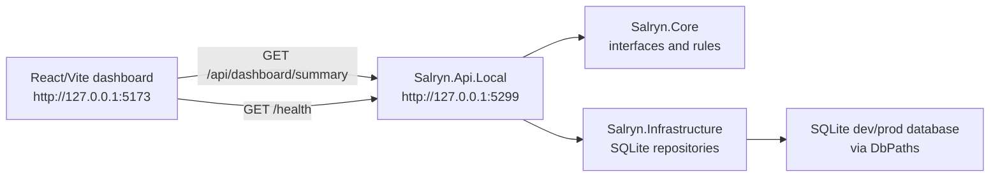
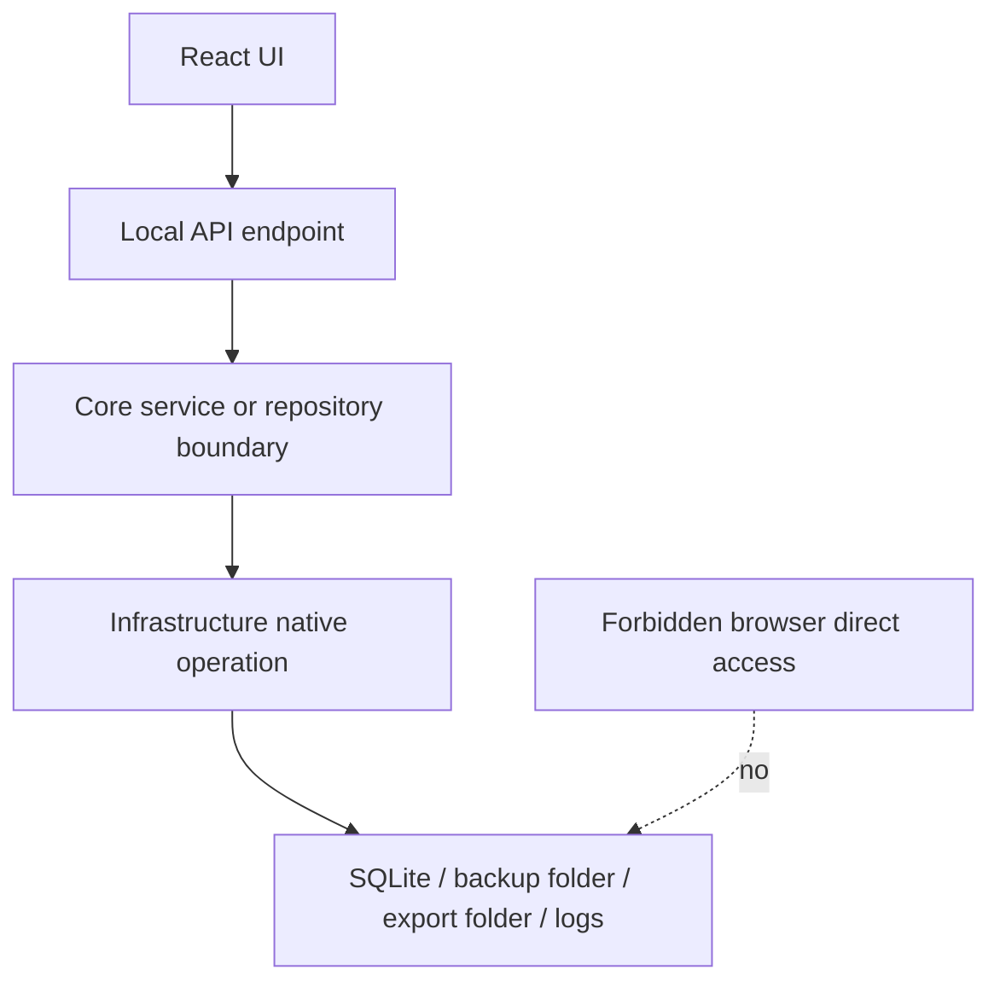
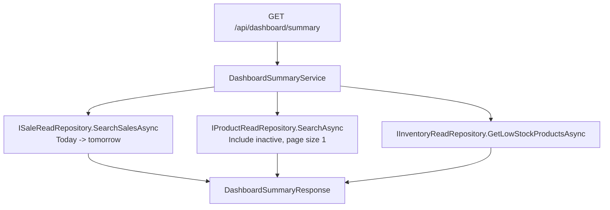
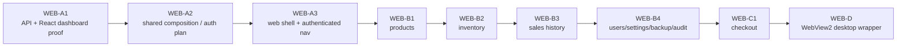

# Salryn Web Frontend Foundation

## Purpose

Salryn keeps its native .NET backend as the source of truth while proving a new Chromium/web operator UI. The web frontend is presentation only. Business rules, SQLite access, filesystem operations, checkout persistence, inventory movement, backup/recovery, audit, and official output remain native .NET responsibilities.

Current WEB-A1 proof:

- `Salryn.Api.Local` exposes a local ASP.NET Core API.
- `Salryn.App.Web` renders a React/Vite dashboard.
- The dashboard reads real backend metrics from `/api/dashboard/summary`.
- WinForms remains the stable fallback.

## Current Project Shape

```text
src/
  Salryn.Core/
    Domain contracts, service rules, repository interfaces, Result/Error types.

  Salryn.Infrastructure/
    SQLite repositories, database initialization, DbPaths, backup/recovery,
    official output filesystem implementation.

  Salryn.Host.Local/
    Core-only local host runtime and handler boundary.

  Salryn.App.WinForms/
    Existing stable WinForms operator app and current production fallback.

  Salryn.Api.Local/
    New local ASP.NET Core Minimal API.
    References Core + Infrastructure only.
    Does not reference WinForms.

  Salryn.App.Web/
    New React + TypeScript + Vite frontend.
    Calls the local API.
    Does not access SQLite, files, printers, or business services directly.

tools/
  Salryn.Tools.CoreSmoke/
    Source and architecture guards.

  Salryn.Tools.InfrastructureSmoke/
    Native regression smoke gates, including POS Phase-B regression.

tests/
  Salryn.Tests/
    Source guards and behavior checks.
```

## WEB-A1 Runtime Flow



## Backend Boundary

The browser must never own local side effects.



Examples:

- Dashboard reads go through `/api/dashboard/summary`.
- Future backup creation should call a native API endpoint, not browser file APIs.
- Future printing/hardware should call a native bridge endpoint, not browser direct hardware access.
- Official output remains behind existing native official output workflow boundaries.

## Local API

Project:

```text
src/Salryn.Api.Local/Salryn.Api.Local.csproj
```

Current endpoints:

```text
GET /health
GET /api/dashboard/summary
```

Security posture:

- Binds to `http://127.0.0.1:5299`.
- Does not bind to `0.0.0.0`.
- Does not use `ListenAnyIP`.
- CORS allows Vite dev origins only:
  - `http://127.0.0.1:5173`
  - `http://localhost:5173`

Run:

```powershell
dotnet run --project .\src\Salryn.Api.Local\Salryn.Api.Local.csproj -- --dev
```

Smoke:

```powershell
dotnet run --project .\src\Salryn.Api.Local\Salryn.Api.Local.csproj -- --dev --smoke-if-supported
```

## Web Frontend

Project:

```text
src/Salryn.App.Web
```

Stack:

- React
- TypeScript
- Vite
- Tailwind CSS
- TanStack Query

Current page:

```text
Dashboard only
```

Run:

```powershell
Set-Location C:\Users\kirch\Salryn\src\Salryn.App.Web
npm install
npm run dev
```

Build:

```powershell
Set-Location C:\Users\kirch\Salryn\src\Salryn.App.Web
npm run build
```

Open:

```text
http://127.0.0.1:5173
```

The API must be running on `127.0.0.1:5299`.

## Dashboard Summary Data



Response fields:

```text
todaySalesTotal
todayTransactionCount
productCount
lowStockCount
refreshedAt
status
warnings
```

## Migration Strategy

WinForms is not deleted. It remains the stable operator fallback while the web UI proves itself module by module.



Recommended next phase:

```text
WEB-A2 - shared native composition and authenticated local API shell.
```

Do not expand endpoints broadly until composition drift is solved.

## Hard Rules

Do not add these unless explicitly assigned:

- product images
- product photo upload
- media upload
- blob image storage
- product file picker
- checkout mutation from web
- sales/payment behavior rewrites
- schema/migrations
- RMO or official output behavior changes
- printer/scanner/hardware
- PDF/Crystal/ESC/POS
- LAN exposure
- WebView2 wrapper

The web frontend must not reimplement business rules. It asks the native API; the native backend decides.

## Verification Baseline

Run from repo root unless noted:

```powershell
git diff --check
dotnet build .\Salryn.sln --no-restore
dotnet test .\Salryn.sln --no-build
dotnet run --no-build --project .\tools\Salryn.Tools.CoreSmoke\Salryn.Tools.CoreSmoke.csproj
dotnet run --no-build --project .\tools\Salryn.Tools.InfrastructureSmoke\Salryn.Tools.InfrastructureSmoke.csproj -- pos-phase-b-regression
dotnet run --project .\src\Salryn.Api.Local\Salryn.Api.Local.csproj -- --dev --smoke-if-supported

Set-Location C:\Users\kirch\Salryn\src\Salryn.App.Web
npm install
npm run build
```

Known warning:

```text
SQLitePCLRaw.lib.e_sqlite3 NU1903
```

Leave it untouched unless specifically assigned.
